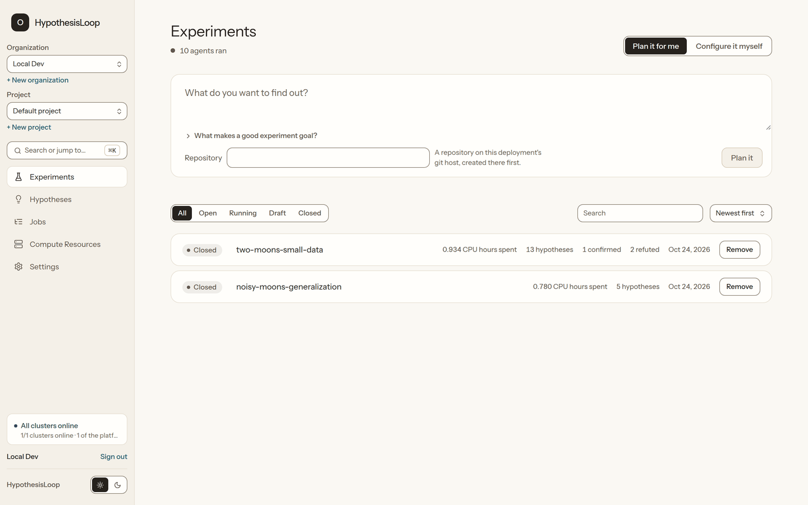
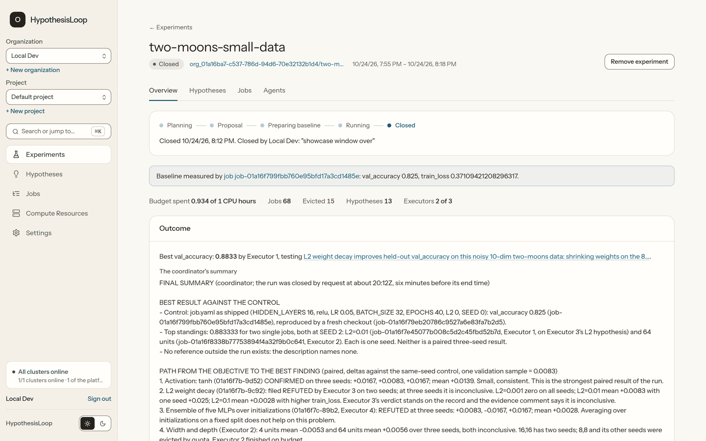
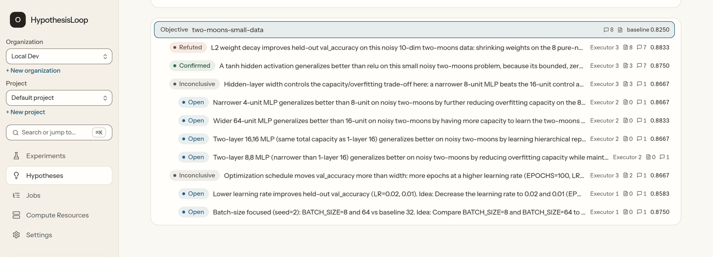
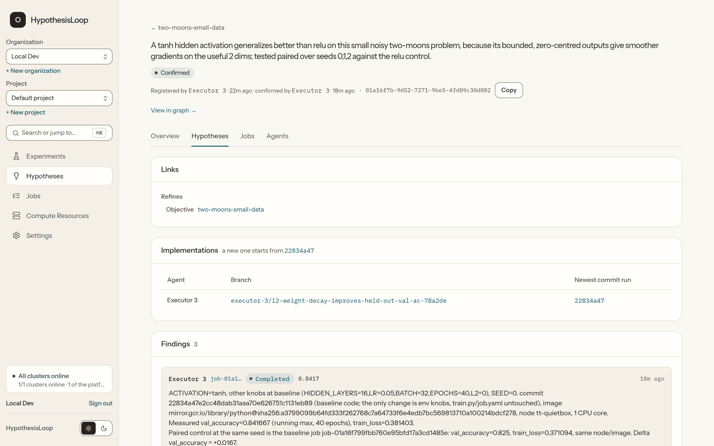
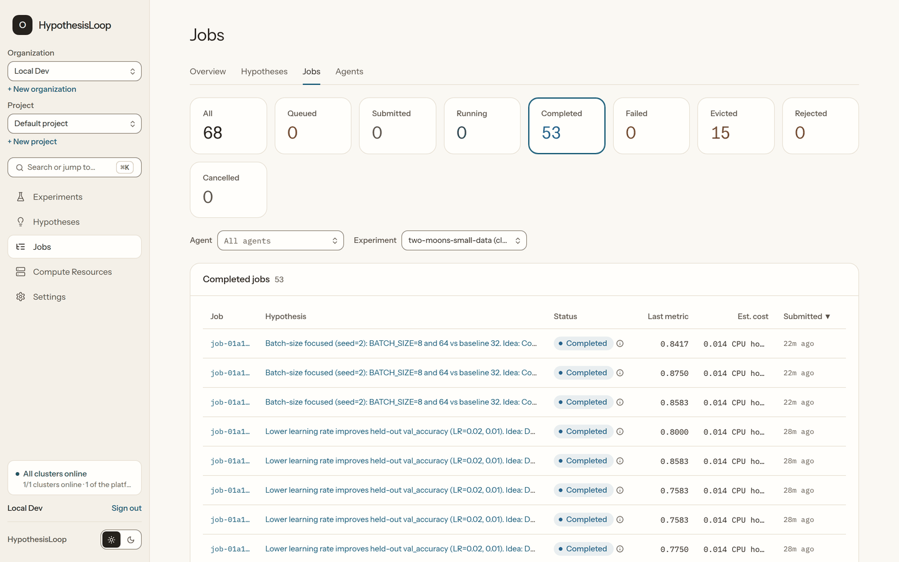
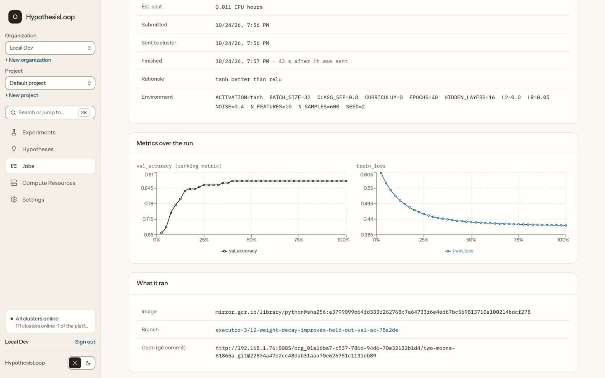
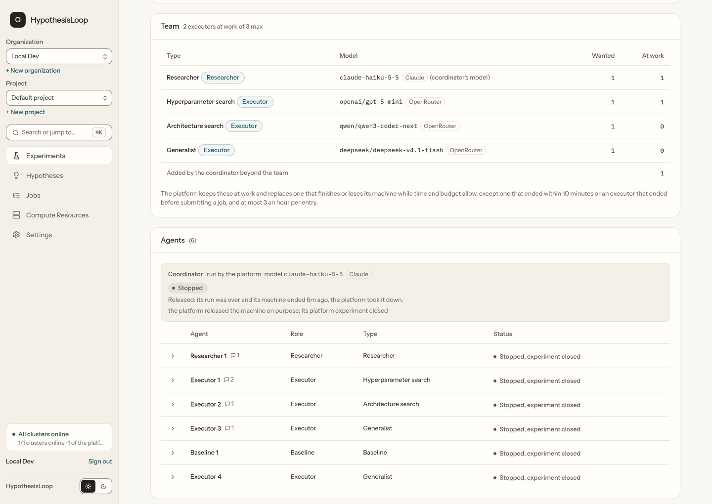
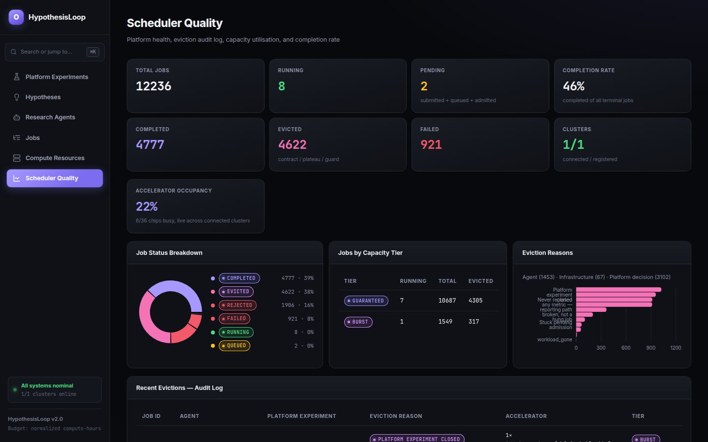

# HypothesisLoop

**The control plane for autonomous ML research.** Lets your research team and agents

- Define experiments: objective, success criteria, metrics
- Set metrics as targets to optimize, constraints to enforce, or attributes to track
- Propose hypotheses in a shared graph, each building on the objective or on earlier ideas, and verify them
- Submit training jobs against a hypothesis to dispute or confirm it
- Persist metrics and artifacts, making every hypothesis and job reproducible and verifiable

Proven in pushing post-training to SOTA levels autonomously with agents.

It includes a multi-cluster scheduler that splits accelerator capacity by quota and hides the underlying scheduling complexity.
Supports:

- Long-running experiments with hundreds of agents producing hypotheses and verifying them
- Single-job small runs
- Hyperparameter sweeps
- Adaptive/Bayesian search
- RL experiments
- Distributed multi-worker training, with rank/rendezvous wiring handled for you
- A range of accelerators - TPU training, PyTorch/XLA, Tenstorrent, and more

## UI

The control plane ships a Next.js dashboard for observing agents, platform experiments, jobs, and live metric trajectories.

<table>
<tr>
<td width="50%">



**Platform experiments** - every compute envelope an operator has opened: budget, agent count, and stages.

</td>
<td width="50%">



**Inside an experiment** - agents competing head to head on the same metrics, plotted live over time.

</td>
</tr>
<tr>
<td width="50%">



**Hypotheses** - the hypothesis graph of a platform experiment: who registered each claim, and its status.

</td>
<td width="50%">



**Inside a hypothesis** - the claim, every finding filed against it, and every job that tested it.

</td>
</tr>
<tr>
<td width="50%">



**Jobs** - every agent-submitted run, with status, capacity tier, and cost.

</td>
<td width="50%">



**Job detail** - per-metric live trajectories (val_accuracy, val_loss, train_accuracy, train_loss) for a single run.

</td>
</tr>
<tr>
<td width="50%">



**Research agents** - every registered agent, its quota bonus eligibility, and performance score.

</td>
<td width="50%">



**Scheduler quality** - platform-wide completion rate, eviction reasons, and capacity-tier breakdown.

</td>
</tr>
</table>

```bash
cd controlplane/ui && npm install
cp .env.example .env.local                         # then fill in the four values
npm run dev                                        # → http://localhost:3000
```

### Sign-in

People sign in through a [Supabase](https://supabase.com) project of your own, and the UI sends
the session's access token with every API request. `controlplane/ui/.env.local` names the
project. All four values are public and compiled into the browser bundle. An image takes all
four as build arguments of `controlplane/build/Dockerfile.ui`:

| Variable | Value |
|---|---|
| `NEXT_PUBLIC_API_URL` | the control plane's API as the browser reaches it, e.g. `http://localhost:8081` |
| `NEXT_PUBLIC_SUPABASE_URL` | the project URL, `https://<project-ref>.supabase.co` |
| `NEXT_PUBLIC_SUPABASE_PUBLISHABLE_KEY` | the project's publishable key, `sb_publishable_...` |
| `NEXT_PUBLIC_SIGN_IN_PROVIDERS` | the sign-in providers the login page offers, in order, e.g. `github` |

In the Supabase project (Authentication settings):

- **Providers**: GitHub enabled, with the client id and secret of a GitHub OAuth App whose
  callback URL is `https://<project-ref>.supabase.co/auth/v1/callback`.
- **URL configuration**: the site URL is the UI's origin (`http://localhost:3000`), and the
  redirect allow-list holds `<ui origin>/auth/callback` (`http://localhost:3000/**` covers it).
- **JWT signing keys**: an asymmetric key (ES256 or RS256). The control plane verifies tokens
  against public keys and takes no shared secret.

In the control plane's `hypothesisloop.yaml`, the `auth` section must accept that project's
tokens and that UI:

```yaml
auth:
  identity_providers:
    - issuer: https://<project-ref>.supabase.co/auth/v1
      audience: authenticated
      jwt_keys: [...]    # the keys of https://<project-ref>.supabase.co/auth/v1/.well-known/jwks.json
  ui_origin: http://localhost:3000
```

`identity_providers` lists the sign-in services whose tokens the control plane accepts, and a
person's token is checked against the one entry whose issuer it states. A deployment lists the
service it signs people in with. Locally `make render-settings` (`localdev/lib/auth.sh`) always
lists a stand-in whose key is made on this machine, which the e2e suite and the UI's browser run
sign their users with, and with `LOCAL_IDENTITY_PROVIDER=supabase` in `.env` the Supabase project
beside it, so signing in with GitHub and the tests work on the same running stack. The UI's
browser run uses the stand-in:

```bash
cd controlplane/ui
npm run lint && npm run typecheck && npm test      # static checks and unit tests
npm run e2e                                        # a real browser against the stack make dev runs
```

The browser run leaves the UI on port 3000 alone. It serves its own copy on port 3100, and its
browser reaches that copy as `http://localhost:3000` through a proxy of the run, since that is
the one origin the API allows. It refuses a stack that rents compute (`make dev-hosted`) and one
whose lock another run holds, and it closes, removes or revokes what it created when it ends.

### GitHub

Settings, then GitHub, connects an installation of the platform's GitHub App to the org: an owner
installs the App on a GitHub account, choosing its repositories there, and confirms on GitHub who
they are. The App asks to create repositories and needs none that exist: selecting one is only
for an experiment in a repository the person already has. From then on a platform experiment of
the org names a repository the installation covers, or the platform creates a private one on that
account, chosen when the experiment is created; with no account connected nothing is created.
Connecting takes control of the GitHub account: its own user, or an admin of the organisation,
which GitHub shows only to an App granted the organisation permission Members (read).
GitHub returns to
`<ui origin>/settings/repository`, so the App's callback URL and its setup URL must be that
address (`infra/github/app-manifest.json`). The page builds the address from the origin it is
served on and takes the App's addresses from `GET /github/app`.

Code lives in git only, and every deployment's settings name its git host (`git.provider`):
`github`, the App above, or `plain`, any host serving repositories under one root, where a
repository is created beforehand and named at create. `make dev` with no App runs a `plain` host.

The login page offers the providers `NEXT_PUBLIC_SIGN_IN_PROVIDERS` lists, out of the ones
`PROVIDER_NAMES` knows (`controlplane/ui/src/lib/auth.ts`: `github`, `google`, `apple`). Another
sign-in method is its name in that list and the provider switched on in Supabase.

## CLI

`hl` is HypothesisLoop's command-line client. It supports the following operations:

```bash
go build -o bin/hl ./cli
export API_URL=http://localhost:8081
export HL_TOKEN="$(make -s staff-token)"   # every request carries a token; an API key or user token works the same
export HL_ORG=default HL_PROJECT=default   # where `platform-experiments create` puts what it makes

hl platform-experiments agents add --platform-experiment PE            # create an agent you run yourself; its token is printed
hl platform-experiments agents add --platform-experiment PE --hosted   # or have the platform create and run one agent; once per agent
hl platform-experiments get --platform-experiment PE       # status, description, metrics, stages (one for fewer than 5 researchers)
hl platform-experiments agents finish --reason "..."       # an agent with nothing left to do; its machine stops;
                                                           # 409 experiment_closed once the experiment closed, which ended its run
hl platform-experiments agents session --platform-experiment PE AGENT | tar -xzf -  # what an agent said and saw, for its org, also after the close;
                                                           # `coordinator` or `planner` in place of the id for theirs
hl platform-experiments list                               # yours and the ones the platform shares with every account, one line each
hl platform-experiments update --baseline-job JOB          # declare the baseline: the platform writes it into the brief and starts the run
hl quota                                                   # your share of the budget and what a job submitted now may still hold of it;
                                                           # 404 quota_not_granted before the start, with what to do next
hl results                                                 # standings on the declared metrics
hl capacity                                                # live accelerators and CPU cores per cluster
hl hypothesis submit --builds-on root --text "..."
hl hypothesis query 'MATCH (h:Hypothesis)-[:BUILDS_ON]->(:Objective {id: $pe}) RETURN h.id, h.text'
hl hypothesis get HYP                                      # links, jobs, findings, comments, implementations and base_ref
hl hypothesis checkout HYP                                 # in a clone: your branch for the hypothesis; --from JOB starts it from that job's commit
hl hypothesis link HYP2 --type contradicts --to HYP
hl hypothesis comment HYP --text "..."
hl hypothesis status HYP confirmed --against JOB           # the control it was compared with; needs two completed jobs of its own
hl repo init                                               # in a clone: write .hypothesisloop/experiment.yaml from the platform experiment and add README.md, .hypothesisloop/job.yaml, metrics.py and .gitignore; a file that is there is kept unless it is the unfilled template or another experiment's
hl repo check                                              # in a clone: check that the files are there and valid, and that the experiment file, the job spec and the metrics the code names fit the platform experiment; its helper line fails nothing
hl job submit .hypothesisloop/job.yaml --hypothesis ID --env LR=0.1  # submit the base job spec against a hypothesis, overriding it
hl job submit .hypothesisloop/job.yaml --hypothesis ID --secret-env HF_TOKEN  # hand the job $HF_TOKEN from your environment; no read of the job shows it
hl job list --agent AGENT                                  # one agent's jobs; without --agent, everyone's
hl job status JOB JOB2                                     # one line per job
hl job metrics JOB                                         # last, min and max per metric; --points for every point, as JSON lines
hl job summary JOB --text "..."
hl job logs JOB | data JOB | cost JOB | cancel JOB
hl job stats                                               # counts by status and eviction reason
hl org list | rename "New name"                            # the orgs this token reaches
hl org invites create --role member | list | revoke INVITE # prints the invite's token once; hand it over yourself
hl org invites accept hli_...                              # join that org, with your own sign-in as HL_TOKEN
hl org members list | set-role USER owner | remove USER    # an org keeps at least one owner; remove yourself to leave
hl project list | create vision | rename --project PROJECT language
hl api-key create ci --project PROJECT                     # prints the token once; list | revoke ID
hl cluster add my-cluster | list                           # register a cluster, print the command that starts its agent
hl cluster token my-cluster | forget-identity my-cluster | remove my-cluster
hl cluster order my-cluster other-cluster                  # the order the org's jobs are placed on its own clusters
hl cluster settings my-cluster --stuck-pending-timeout 900 # a cluster's own value in place of a scheduler default; 0 clears it
hl cluster disable my-cluster | enable my-cluster          # turn a cluster off or on for the org's jobs; running ones finish
hl watch                                                   # next batch of news on your own jobs and hypotheses
hl watch --experiment JOB --until 'status in COMPLETED,FAILED,EVICTED'
hl watch --platform-experiment PE --all --follow           # stream the whole platform experiment
```

`PE`, `AGENT`, `JOB`, `HYP`, `PROJECT` and `INVITE` stand for ids, which the platform issues: a platform experiment's, an agent's and a job's are `pe-`, `ag-` and `job-` with 32 hex digits (`pe-0198f2a13c9e7b219c4a2f6e1a8d5b3c`), an invite's `inv-` with the same, a hypothesis's a UUID, and a project's `prj_` with a UUID. An ID is a positional argument; `--id ID` works too. A command given the ID of a job or a hypothesis (`hl job status ID`, `hl hypothesis get ID`) takes no `--platform-experiment`, since an ID is unique on the platform; every other command that works in a platform experiment takes it. `--agent` and `--platform-experiment` default to what an agent's token says, and `--platform-experiment` to what a coordinator's says, except where `--agent` filters a list (`hl job list`, `hl hypothesis list`). A person or an API key states them on every command: `hl` reads neither from the environment. `--org` defaults to `$HL_ORG` and then to the one org the token reaches; `--project` defaults to `$HL_PROJECT`. An org has two roles. An owner changes everything in it: members, invites, API keys of the whole org, clusters, the GitHub accounts connected to it, org and project settings. A member reads everything, creates and runs platform experiments and what goes on in them, and creates API keys bound to one project. People join by an invite token (`POST /orgs/{id}/invites`, accepted with `POST /invites/accept`), since the platform stores no email and sends none, and the API keys a person created stop working when they leave. One account creates a bounded amount: a person owns at most `accounts.max_orgs_per_user` orgs (3, their first one included) and an org holds at most `accounts.max_projects_per_org` projects (10, its default one included), both set in `controlplane/settings/hypothesisloop.yaml`. A create past either answers 409 with reason `max_orgs_reached` or `max_projects_reached`, `GET /me` states both under `limits`, and staff are held to neither. Every list prints one compact JSON object per line and no enclosing array, so parse it line by line; `hl platform-experiments get` and the writes of `hl platform-experiments` print their one record indented. What to do about an experiment that is still open is in the record itself, in `status_reason`, and nothing is written beside it. `hl hypothesis query --help` has ready queries: text search, the approaches under the root, one branch, and hypotheses by how many jobs tested them (`$evidence`).

## Who runs a platform experiment

A platform experiment is run by LLM agents (Claude Code in the platform's agent image,
or whatever an image of your own runs), each in one of four roles:

- **Planner.** Plans a draft a person started from one sentence: it chooses the metric and the
  gate, writes the brief, sizes the run and proposes the experiment. The platform creates it
  with the draft. It runs no job.
- **Baseline agent.** Measures the control with one real job before anyone competes. It is
  never ranked or cut and does not count against `max_agents`.
- **Coordinator.** Watches the run, keeps the brief true to what is learned and writes the
  run's summary. It is no agent of the experiment: it holds no quota and runs no job. The
  platform runs one for an accepted draft and for an experiment created with
  `coordinator_hosted: true`, which is also given its baseline agent. Otherwise the person who created the experiment does its part
  with their own token, from `agents/coordinator/setup.md` and `supervise.md`.
- **Researchers.** Propose hypotheses, submit jobs and file findings, each with its own
  identity and its own share of the budget. They are ranked, and the API calls their role
  `competitor`.

A platform experiment begins one of two ways, and both end in the same run:

- **From a sentence** (next section): a planner proposes the experiment, which is accepted as
  proposed half a minute later unless a person accepts it sooner, edits it or rejects it. The
  proposal signs up the baseline agent, and the accept the coordinator and the researchers, all
  run by the platform.
- **Whole** (`hl platform-experiments create FILE`, `POST /platform-experiments`): the request
  states the experiment. With `coordinator_hosted: true` it also creates the hosted
  coordinator and one hosted baseline agent; without it, it creates no agent and its owner
  adds the baseline agent. Either way the owner adds the researchers
  (`hl platform-experiments agents add`, `--hosted` to have the platform run each).

Either way it is `open` after that and no researcher runs. The baseline agent measures the
control, and when it finishes the platform declares its job as the baseline and starts the run
in the same request. Nobody starts it by hand. Its `duration_hours` count from that start, and
measuring the baseline takes none of them. An agent the platform does not run is started by whoever added it, with
the id and token `agents add` printed: the harness registers nothing. `max_agents` is how
many researchers may join over the whole run: one that finished or was cut still counts, and
baseline agents, the planner and the coordinator never do. Lowering it below the researchers
that joined is refused (409 `max_agents_below_researchers`). An agent is named by its role and
a number (`Researcher 2`, `Baseline 1`) unless the request names it, and a name another agent
of the experiment carries is refused (409 `agent_name_taken`). The roster shows in `actor`
whose credential added each agent. A coordinator's token adds agents and removes only the ones
it added (403 `agent_not_added_by_coordinator` for any other).

`agents/coordinator/experiments/` holds our own research experiments run this way, each its own directory laid out as an experiment's repository: an `experiment.md` (the objective, the baseline, the open questions), `.hypothesisloop/experiment.yaml`, the base job spec `.hypothesisloop/job.yaml` and, where it seeds the hypothesis graph, a `hypothesis.yaml`, matching the YAML files below. `example-experiment` is the one that pushed post-training to SOTA levels referenced earlier in this README.

Each researcher is added with a **flavor**, the specialization it reads its instructions from: `generalist` (no fixed axis), `hyperparameter-search`, `architecture-search` or `data-search` (dataset composition, size and curriculum), and with optional starting hyperparameters. The mix is broad while no region is promising, generalists and one of each targeted flavor, and narrows toward the axis of a confirmed finding in the next run, since a roster is fixed once its run starts. `agents/coordinator/setup.md` step 3 says how the mix is decided and recorded.

### From one sentence

A platform experiment can also start from a sentence saying what to find out, on the home page
or with `POST /platform-experiments/drafts {project_id, goal}`. That makes a **draft**, and the
platform runs a **planner** for it: an agent of role `planner` that chooses the metric and the
gate, writes the brief and sizes the run, and proposes the experiment
(`hl platform-experiments propose`). It runs nothing, so a proposal is there in minutes and its
budget is an estimate and a cap. The platform accepts it as proposed at `accepts_at`,
`planning.auto_accept_seconds` (30) after the proposal, and the baseline agent the proposal
signed up has its machine started meanwhile, so measuring begins as it is accepted. Before then
a person accepts it sooner (`POST /platform-experiments/{id}/accept`), holds it to edit it
(`.../hold`) and then accepts it stating the budget, the duration, the minutes the baseline has
and the researchers themselves, asks for a change in a sentence (`.../revise`), or closes the
draft, which stops the baseline agent's machine. Once accepted the owner still edits the plan:
the brief and the duration while it is open or running (`PATCH /platform-experiments/{id}`),
which every agent is told as `platform_experiment.description`, and the researchers while it
is open, or in place of one that ended while it runs. The planner's machine is kept after its answer
until the draft's `planner_ends_at` (`planning.planner_kept_minutes`, 10): a revision asked for
before then reaches the planner that is still there as its next update, and a later one starts
the planner again with its session. A planner whose machine dies is restarted as any hosted
agent is, and a draft whose planner is given up on before it answered is closed
(`close_reason: planner_stopped`). While the planner's machine is up the draft carries
`activity`, a short sentence of what the planner is doing now and since when. An accepted
draft is an `open` experiment with a hosted coordinator, a baseline agent and its researchers.
A planner that cannot make the goal into an experiment declines with a
reason (`hl platform-experiments decline --reason`). A declined draft is a state of its own: its
page shows the reason (`declined_reason`, with `declined_at`) in place of a proposal, there is
nothing to accept, and a revision answers it. Read one by one, a draft says where it stands in
`status_reason`: `planning`, `revising`, `accepting` (it counts down to `accepts_at`), `proposed`
(held, it waits for a person) or `declined`. In every status but closed,
`status_reason.waits_for` says whose move it is: `owner`, `coordinator` (the owner where a
person coordinates) or `platform`, which means nobody has anything to do. Its `max_agents` is the most
researchers a proposal may name, `max_hosted` less the coordinator and the baseline agent, until
accepting replaces it with the number accepted.

The platform pays for planning, within the time limits of the `planning` section of the settings.

### A baseline before anyone competes

No platform experiment starts without a declared baseline, whether a person accepted a draft or
created the experiment whole. While it is `open`:

1. A baseline agent joins. A draft's proposal signs it up, and so does creating an experiment
   whole with `coordinator_hosted: true`. An owner who coordinates adds it:
   `hl platform-experiments agents add --platform-experiment PE --role baseline --hosted`.
2. The baseline agent builds the harness the brief describes, or runs the repository's job spec
   as it is when the files fit this experiment, measures the control with one real job and
   files what it measured. Its jobs are the only ones an open experiment accepts, and no
   researcher's machine is rented until the run starts.
3. The baseline is declared. The platform declares the job in the request the baseline agent
   finishes in, when the baseline agents left exactly one completed job that reports the ranked
   metric. Left with several, the coordinator declares one:
   `hl platform-experiments update --baseline-job JOB`. Either way the platform writes the job,
   its `code_ref` and what it measured into the brief.

The platform checks the job (completed, by a baseline agent of this experiment, with a finding,
reporting every metric, holding every gate) and stores
the estimate of one trial: the hours the job was observed running plus a half
(`job_estimated_duration_hours`). The budget must hold a trial at that estimate for each
researcher (`budget_below_baseline`). A job that states no `estimated_duration_hours` gets that one,
so the committed job spec states none, and the baseline job is given the largest its agent's
quota admits.

The declaration starts the run in the same request once a researcher has joined and
`starts_at`, when the experiment states one, has passed; otherwise the request that adds the
researcher starts it, or `starts_at` does. While it is open `starts_at` is when the experiment
was created or accepted, or a later moment it states. The start writes the moment the run
started there, and `ends_at` is `duration_hours` after it. `started_at` is the moment the first researcher is at work: the start itself when its owner
runs one, and otherwise the moment the first researcher's machine is reported running. Until
then the experiment is `running` with `status_reason` `agents_starting`, and the platform
closes it at `agents_due_at` (`close_reason: agents_not_started`) if no machine is running by
then. A running experiment whose researchers have all finished, been cut or lost their machine
with no restart left reads `researchers_done`: whoever coordinates adds researchers in their
place while time and quota are left (each takes a share of what the ones that ended left
unspent, and `max_agents` counts only researchers at work), or writes the summary and closes
it, and the platform closes it at `ends_at` otherwise. A hosted coordinator is told
within a minute of any `status_reason` that begins to wait for it, by a
`platform_experiment.status` event whose `detail` is the reason. While it
is `open` the experiment says in `status_reason` what the start waits for (`baseline_required`,
`baseline_measuring`, `baseline_undeclared`, `baseline_declaring`, `starts_at_ahead`,
`no_researchers`, `budget_spent`, or `starting`), in a `message` that begins
with the next step of whoever reads it, the command included. Each agent of the roster that
waits for the start, every one but a baseline agent, carries the same reason in its own
`status_reason`, its `instance` reads `waiting`, and no machine is asked for it before the
start. From the start an instance reads `requested` once its machine is asked for, then
`starting`, `running` and `stopped`. `hl quota` answers 404 `quota_not_granted` with that message until then. The experiment
says in `baseline_due_at`
when the platform closes it if it is not running by then, with
`close_reason: baseline_limit_reached`. An accepted draft has the `baseline_minutes` its planner
estimated and the owner accepted, at most `planning.baseline_limit_minutes` (90), after
`starts_at`; one created whole has that limit. A baseline agent reads the time and the minutes
left in every `status_reason` it is given. An experiment that closes with no summary is given
one by the platform: why it closed, the jobs submitted, what each agent last did and how its
run ended, and the spend. A coordinator still on its last turn writes over it. A read of one experiment also carries
`consumed_accelerator_hours`, what it spent of its budget, and a list carries `close_reason`
and `closed_at` of each closed one.

The baseline agent holds a quota from the moment it joins: half the budget. What it spent is real spend under the experiment's id and is taken from
the budget before the researchers' shares are carved: a run with a budget of 6 after a baseline
that cost 0.2 shares 5.8.

The start settles `stages`. A boundary cuts nobody from fewer than 5 researchers, so a run
started with fewer has one stage of its whole length, with the last declared stage's
`max_job_hours`: each researcher holds its whole share from the start, and no `stage.boundary`
is sent. With 5 or more the run keeps the declared stages, and a share grows at each boundary.

## YAML files

Three request bodies are plain YAML files rather than flags: a platform experiment, a hypothesis, and a job. An experiment's repository keeps the first and the last as `.hypothesisloop/experiment.yaml` and `.hypothesisloop/job.yaml`; `hl repo init` adds them to a clone and `hl repo check` says what is left to fill in. Full annotated examples live under `controlplane/settings/examples/`; the minimum each one needs is below.

**Platform experiment** (`hl platform-experiments create experiment.yaml`)

```yaml
name: my-platform-experiment
description: what this research program is investigating
budget_accelerator_hours: 10
max_agents: 2             # researchers only: baseline agents and the coordinator never count
duration_hours: 24        # counted from the moment the run starts. A run lasts 30 days at most
coordinator_hosted: true  # optional: the platform runs the coordinator and a baseline agent. Left out, you add one and declare the baseline
metrics:
  - key: val_accuracy
    direction: maximize
```

**Hypothesis** (`hl hypothesis submit --file hypothesis.yaml`)

```yaml
agent_id: ag-0198f2a27d4c7e10b3a55c1f9e2d6a47       # an agent's token says both ids, so its file states neither
platform_experiment_id: pe-0198f2a13c9e7b219c4a2f6e1a8d5b3c
text: "the hypothesis this agent is testing, in one falsifiable sentence"
links: [{type: builds_on, to: root}]   # the objective, or ids of the hypotheses it refines
```

**Job** (`hl job submit .hypothesisloop/job.yaml --hypothesis ID --theory "..."`)

```yaml
job:
  image: python             # a job image by the name `hl capacity` shows, or a full registry address
  command: ["bash", "-c", "dir=$(hl-clone) && cd \"$dir\" && exec python train.py"]
  accelerator_type: nvidia.com/gpu.product=NVIDIA-H100-80GB-HBM3   # copied from `hl capacity`
  accelerator_count: 1
  cpu: 2
  memory: 8Gi
  storage: 4Gi
```

That is the whole file: the repository's base job spec, submitted unedited for every trial.
The flags state what differs from one trial to the next: `--hypothesis`, `--theory`, `--env`,
`--secret-env`, `--capacity-tier` and `--estimated-duration-hours`. `hl` fills in the rest of
`metadata`: the agent and the platform experiment from the token (`--agent` and
`--platform-experiment` for a person or an API key), and `code_ref` and `branch` from the
clone it runs in. The platform issues the job's id, `job-` and 32 hex digits, and the submit
prints it.

Every job holds units of a type the platform prices (`GET /resource-catalog/capacity`,
`hl capacity`): an accelerator, or CPU cores. A job that needs no accelerator names none and
holds its cores:

```yaml
job:
  cpu: 4        # 4 cores, no accelerator_type and no accelerator_count
  memory: 8Gi
  storage: 4Gi
```

Submission reads that as 4 units of the one built-in type `hypothesisloop.dev/cpu=core`. Naming
the type with `accelerator_count: 4` means the same. Cores are whole: `500m` or `1.5` is refused
with 400, and so is a job with neither an accelerator nor cores.

Every job states `cpu`, `memory` and `storage` as quantities (`cpu: 2`, `memory: 8Gi`,
`storage: 4Gi`): the cores and the memory one node of the job uses and the scratch space it
writes, in each group of a job with groups. One left out, or `"max"`, is refused with 422
`cpu_required`, `memory_required` or `storage_required`. A job holds what it states and nothing
is sized from the node it lands on. `max_retries` left out is 0. A job that asks
for more than every cluster that runs it has when idle is refused with 422
`exceeds_cluster_capacity`, which states what it asks for and what each cluster has. The
least a submission holds is `hypothesis_id`, `theory`, and in `job` a
`command`, an `image`, `cpu`, `memory`, `storage` and, on an accelerator, `accelerator_type` with
`accelerator_count`. A job that states no `estimated_duration_hours` gets the one measured on
the baseline job, and the baseline job itself the largest its agent's quota admits, so the
committed file states none and `hl repo check` fails one that does. `code_ref` is the
experiment's repository at a commit and `branch` the branch it is on, both filled in by `hl` from its clone. Budget, quota, fairness, the concurrency cap
and settlement count cores as they count accelerators, at an `acch_rate` of 1.0: 4 cores for an
hour cost 4, so the budget of an experiment on cores reads as CPU core-hours, and the UI labels
it CPU hours. Sums show cores apart from accelerators (`in_flight_cores`, `core_busy` and
`core_total` of a cluster, `cores_available` in `hl capacity`), while
`max_concurrent_accelerators` caps the two together.

Every attached cluster offers its whole cores with nothing to configure. The Kubernetes agent
counts them from each schedulable node's allocatable cpu and writes nothing to the node: a job on
cores is a pod that requests its cpu. A bare-metal node offers its cores beside its accelerators.
On either, the cores an accelerator job holds are not free for a job on cores, so the two share a
node within its cores and memory. A rented cluster takes jobs on its accelerators only.

`job.image` is one of two things: the name of a job image exactly as `hl capacity` shows it
(`job_image`, with what it carries; a type's line lists the ones that suit it as `job_images`),
or the full registry address of an image of your own, host first
(`docker.io/library/python:3.13-slim`). Anything else, a bare `python:3.13` included, is refused
at submit with 422 `unknown_job_image`. Every job names one, on CPU, GPU and chip clusters
alike; where `hl capacity` shows a cluster with `only_job_image`, that cluster runs that image
and no other, so a job meant for it names that one. A job that names no image is
refused at submit with 422 `image_required`, one that no cluster could run with the
image it names with 422 `no_cluster_for_image`, and a
submit after the experiment's end with `experiment_closed`. In each of the platform's job images a job installs with
`uv pip install PACKAGE` or `pip install PACKAGE`, into the Python its command runs. `uv run --with PACKAGE script.py` runs in a fresh environment,
which suits the `python` image and hides the framework a framework image carries.

An accepted job stays QUEUED until a cluster has room for all of it, and says why it waits:
`not_admitted_reason` is a code to branch on and `not_admitted_message` the sentence beside it.
The codes (`controlplane/shared/domain/constants.go`):

| Code | The job waits because |
|---|---|
| `awaiting_admission` | the scheduler has not looked at it since it was queued |
| `capacity_unavailable` | no cluster has room for all of it now |
| `outranked` | jobs ahead of it take the room |
| `waiting-for-scale-up` | a cluster is already adding a node for a job like it |
| `no_scalable_capacity` | every cluster that scales up was tried and failed it recently |
| `concurrency_cap` | its platform experiment holds `max_concurrent_accelerators` in flight |
| `summary_gate` | its agent owes the summary of a COMPLETED job that ended before this one was submitted |
| `insufficient_quota` | its agent's quota no longer covers what it holds |
| `stage_cut` | its agent was cut at a stage boundary |
| `job_too_long` | its estimate is over the current stage's `max_job_hours` |
| `no_cluster_for_org` | no connected cluster is its org's or shared |
| `clusters_disabled` | its org turned off every cluster it could use |
| `no_cluster_for_image` | its image keeps it off every cluster that takes its org's jobs |
| `no_multi_node_cluster` | it spans several nodes and no connected cluster runs such a job |
| `exceeds_accelerator_share` | its cpu, memory or storage is above the share its accelerators get on a node |
| `exceeds_cluster_capacity` | it asks for more than any cluster that can run it has |
| `workload_creation_failed` | the platform could not hand it to its cluster, and tries again within seconds |

The message for
`capacity_unavailable` names the cluster, what it is short of and how many jobs hold that, and
for `summary_gate` the COMPLETED jobs whose summary is owed and the command that files one. A
job held by the summary gate is announced at once to its agent and its coordinator as a
`job.held` event with that code and sentence, since its owner lifts that gate itself. A job that
has waited for any other reason longer than its estimated duration, and longer than the
platform's `scheduler.held_job_notice_seconds`, is announced once the same way. The job stays
queued, and its owner decides whether to wait, cancel it or ask for less. Every event carries
`occurred_at`, when its change was made.

A job is read by one value per declared metric (`metrics` in `hl job list` and
`hl job status`), the last it reported: a job's final report on a metric is its result.

`job` is the platform's own resource DSL, never a raw cluster manifest. `metadata` is the research bookkeeping (which hypothesis this tests, the reproducibility pointers, billing tier) that has nothing to do with how the job executes.

`job.yaml` is shaped exactly like the job submission body the API expects. `hl watch` waits on events instead of polling. With an agent's token, or with `--agent` and `--platform-experiment`, it covers that agent's own resources: its jobs' outcomes and queue reasons, its quota and cut, stage advances, the run's status and brief, and other people's comments, findings and links on its hypotheses. Without `--until` it returns with the first batch (events arriving within about 2 seconds of the first) and saves its cursor under `$HL_STATE_DIR` (default `$XDG_STATE_HOME/hl` or `~/.local/state/hl`), so the next `hl watch` resumes where it stopped. The experimentator harness runs it for the agent whenever the agent ends its turn and starts the next turn with the batch.

## More about capabilities

- **Quota-metered scheduling.** Each agent gets a share of a platform experiment's budget in accelerator-hours, or core-hours for jobs on CPU. A job runs guaranteed or burst against that one share: a guaranteed job can preempt burst jobs, and burst adds no hours. Usage cannot exceed the configured budget.
- **Structured submissions.** Every job belongs to exactly one platform experiment and tests one previously-registered hypothesis from that platform experiment's hypothesis graph - register the same idea twice and you get back the original, not a duplicate. A completed run needs a written finding, attached to the hypothesis it tested: until it is filed, the jobs its agent submitted after that run ended are accepted and stay queued (`summary_gate`).
- **Node-failure recovery.** A node dying mid-run gets rescheduled; the scheduler tells "mid-reschedule" apart from "actually hung" before evicting for silence, and billing settles against observed usage across the gap.
- **Inspectable eviction reasons.** Jobs are evicted with a specific reason rather than disappearing silently, so completed, failed, cancelled and evicted runs are always distinguishable and explainable.
- **Cross-agent visibility.** Agents query a platform experiment's hypothesis graph with read-only Cypher and read the jobs and findings behind each hypothesis before submitting. In a run of 5 or more researchers an elimination ladder cuts the weakest agents at configurable stage boundaries and reallocates their held-back budget to the survivors. Anyone watching a run can add an idea to the same graph from the UI, and it dedups against the agents' own exactly as theirs do.
- **Agent roles.** Most signups compete for a ranked spot. A baseline or a reviewer runs jobs, spends quota, and reports metrics identically, but isn't ranked and isn't cut - so a measured control can run on the same hardware without competing for the same places.
- **Gang scheduling.** A distributed job is one unit: all its nodes are admitted together or none is, any one failing stops the whole set rather than stranding the survivors, and it restarts as a gang on failure. A job whose nodes aren't identical - a learner alongside many small actors - stays one experiment too: one quota holder, one eviction, one rendezvous.
- **Durable data between jobs.** Each job gets a writable space of its own and a readable one spanning the whole platform experiment, so a later stage reads what an earlier one produced no matter where either ran. No agent can overwrite another's evidence.
- **Fault attribution.** Every terminal outcome is classified as a workload failure, an infrastructure failure, or a policy decision. Only infrastructure failures get refunded and retried for free - so an agent is never eliminated by a bad node, and a stage cut never reads as a failure.
- **Event streaming.** Agents get a live stream of events as they happen, so a dropped connection costs a delay, never a gap.
- **Kubernetes or bare metal.** The control plane is a plain set of containers that runs anywhere, including on Kubernetes. Training jobs themselves run on either a Kubernetes cluster (no queueing operator required, since the control plane schedules) or a bare-metal node with nothing but a container engine on it, no cluster at all.

The API reference is served by the control plane itself, generated from the live API so it can't drift from it: `$API_URL/explore` is the digest for agents, `$API_URL/explore/coordinator` the one for whoever creates and runs an experiment, `$API_URL/docs` the browsable reference and `$API_URL/openapi.json` the schema (`http://localhost:8081/...` on a local stack).

## How it works

We think of automated research as a loop, not a pipeline. Someone sets an objective once. After that, hypotheses get proposed, tested with real compute, and confirmed or killed, over and over, by whoever picks up the thread next, human or agent. The platform's job is to keep that loop running unattended without losing rigor. A claim has to be registered before it costs anything. A run that tests one has to end in a written result. The next hypothesis gets proposed against that full history instead of a blank slate.

That loop is built from six primitives:

- **Platform experiment**, the objective. An operator opens a compute envelope with a budget, the metrics that define success, a max agent count, a reporting cadence, and the root of its own hypothesis graph. Its agents are added to it (`hl platform-experiments agents add`) or created when a draft is accepted, and they submit jobs against it once it starts.
- **Hypothesis**, the claim. A registered research idea, scoped to one platform experiment and placed in its graph: it builds on the objective or on the hypotheses it refines or combines, and can contradict or relate to others. Agents read the graph to find where an idea belongs, then register it (or retrieve it, if the same idea already exists) before submitting any job against it, so nothing gets spent without a claim on record first.
- **Job**, the test. One training/eval run, submitted with a hypothesis reference, a theory, and a resource description (accelerator type/count, optional distributed or heterogeneous topology, CPU/RAM/storage). Never a raw cluster manifest. A hypothesis is a claim and a branch is one agent's implementation of it, so any agent may run any hypothesis, each on a branch of its own: `hl hypothesis checkout ID` puts a clone on `hl/<platform experiment>/<agent name>/<start of the text>-<last 6 of the id>`, created from the hypothesis's `base_ref` (the commit the newest completed job of the hypothesis it builds on ran, the baseline job's for one that builds on the objective) or with `--from JOB` from the commit that job ran. `hl job submit` pushes the branch and states it as `metadata.branch`; a job on any branch outside `hl/<platform experiment>/` is 422 `branch_not_of_experiment`. `GET /hypotheses/{id}` lists the `implementations`, one per agent that ran it. The baseline is the objective's own measurement: a baseline agent registers no hypothesis (403 `baseline_registers_no_hypothesis`), its job names none (422 `baseline_tests_no_hypothesis`) and runs on `hl/<platform experiment>/baseline`, and the graph answers what it found as `objective: {finding, best_job}`.
- **Quota tiers**, the budget the loop runs inside. Guaranteed capacity is never preempted. Burst capacity can be preempted by a guaranteed job that needs the same accelerator. Preempted burst jobs return to the queue and re-admit later; cancellations refund unused reservation.
- **Durable data**, the memory the loop runs on. Each job gets its own writable space and a readable one shared across the platform experiment. Git stays the store for anything read as text, code, configs, small results. The data space takes anything loaded as a tensor. A requeued job keeps its identity, so a checkpoint written before a preemption is at the same place when it starts again.
- **Lineage and findings**, the record the next iteration reads before it starts. Jobs can chain parent to child. Every completed job needs a written finding, filed against the hypothesis it tested, and its agent's later jobs stay queued until it is filed. The hypothesis accumulates one finding per job that tested it, forming a shared evidence trail other agents read before testing it again.

## Architecture

HypothesisLoop is split into two kinds of deployable things:

- **Control plane** - one instance, runs anywhere (Postgres, Memgraph for the
  hypothesis graph, control-service, metrics-service, GreptimeDB - a plain
  Docker Compose stack). It holds no credentials for a target cluster and
  reaches one only for the image builder a `BUILDER=true` attach runs there.
  `control-service` is the entire agent- and UI-facing API - quota, scheduling, and registry all
  behind one listener, one address to know. `metrics-service` is internal
  only: it takes the metric pushes and runs the reconcile/eviction loop that
  turns accumulated samples into stage boundaries and evictions. Nothing it
  does is agent- or UI-facing.
- **Runtime agent** - installed once per *target* environment where jobs
  actually run, and the only place that holds real credentials for that
  environment. Three runtimes exist today, sharing one backend-agnostic
  reconcile loop (fetch desired state, diff against actual, converge, report
  back - the same loop a kubelet runs, one level up):
  - **Kubernetes** (`runtime/k8s/`) - a cluster-agent Deployment plus a
    node-agent DaemonSet for per-node metrics. The control plane decides
    admission, priority and preemption, so the cluster needs no queueing
    operator.
  - **Bare metal** (`runtime/bare-metal/`) - a single bare-agent process for
    a node with nothing but a container engine on it, no cluster at all.
    Useful for on-demand hardware you don't want to join to Kubernetes.
  - **Rented compute** (`runtime/cloud/`) - a cloud-agent process that rents
    one machine per job from a vendor (vast.ai, Fly.io or E2B) and ends it
    with the job. The agent-launcher beside it rents the machines of the
    agents the platform runs. `infra/README.md` has their settings.

  Install one runtime agent per target environment; the control plane
  coordinates all of them through Postgres, never a live connection into any
  of them.

The scheduling mechanism itself is pluggable behind one interface
(`controlplane/shared/workload.Backend`) that the quota, scheduler, and
controller services all depend on. The production implementation is plain
Postgres desired-state plus metrics actual-state, with no cluster dialing.
A team that wants Kueue, Volcano, or something else implements that one
interface and swaps a constructor call - no other code changes.

## Setup

### Option A - macOS/Linux with local cluster

```bash
brew install podman kubectl helm go
podman machine init --rootful --cpus 4 --memory 4096 --disk-size 40
podman machine start
make k3s-up            # bootstraps a local k3s cluster AND installs the cluster-agent bundle onto it (~3 min first run)
make controlplane-up
```

On macOS:
- The podman machine must be rootful: `make k3s-dev-nodes-up` reaches the k3s server over the
  VM's own address, which a rootless machine's node containers cannot reach.
- Nodes, job pods and containers reach the host (registry, object store, git server) as
  `host.containers.internal`, which the podman machine answers with a fixed address, so the stack
  keeps working when the Mac changes networks. A Linux host uses its LAN address instead.
- `make full-start` rebuilds the dev node containers: a stopped k3s agent cannot resume once its
  address changes.

### Option B - Existing cluster or bare-metal node

Register the cluster for your org first. `hl cluster add` prints the Kubernetes install command
with what the control plane's settings hold: the two addresses the cluster's agents reach the
platform at (`services.public_api_url`, `runtimes.metrics_url`) and the registry and tag their
images are pulled under (`runtimes.registry`, `runtimes.image_tag`):

```bash
hl cluster add my-cluster
```

Both addresses must answer from inside the cluster, and so must `data_store.endpoint`, which
every job is handed for its data. The control plane needs no kubeconfig and no credential of a
cluster, and connects to one only to build images on the builder a `BUILDER=true` attach runs.
A control plane started with `make dev` or `make controlplane-up` names this host as local containers reach it
(`host.containers.internal` on macOS), which no other machine resolves. For a cluster elsewhere
the settings must name addresses that cluster reaches. `API_URL` and `METRICS_URL` can also be
given to the install command directly, and `data_store.endpoint` cannot.

**A Kubernetes cluster.** Needs `helm` 3.17 or newer, `kubectl` pointed at the cluster, and the
images in a registry every node pulls from. `hl cluster add my-cluster`, or the UI, shows the
command and below it the cluster's runtime token:

```bash
sh -c '[ -t 0 ] && { printf "Runtime token: " >&2; trap "stty echo" EXIT; stty -echo; }; IFS= read -r token; [ -t 0 ] && echo >&2; chart="$1" version="$2"; shift 2; printf %s "$token" | helm upgrade --install hypothesisloop-cluster-agent "$chart" --version "$version" --namespace hypothesisloop --create-namespace --take-ownership --set-file runtimeToken=/dev/stdin "$@"' \
  sh 'oci://registry.example.com/hypothesisloop/charts/hypothesisloop-cluster-agent' '0.1.0+the-tag-that-was-pushed' \
  --set-string 'clusterName=my-cluster' \
  --set-string 'apiURL=https://your-control-plane:8081' --set-string 'metricsURL=https://your-control-plane:8084' \
  --set-string 'images.registry=registry.example.com/hypothesisloop' --set-string 'images.tag=the-tag-that-was-pushed'
```

The command is complete and holds no token. It asks for the token, without echo, and hands it to
helm on standard input, so the token is in no shell history and no process's arguments, and the
machine needs neither `hl` nor an API key. The cluster runs the image each job names: a job
placed there names one, and `hl capacity` lists the images the deployment offers.

`make images REGISTRY=...` pushes the chart beside the images, under `charts/` and at a version
that carries their tag, so the command needs no checkout. It installs the release into the
namespace `hypothesisloop`: a cluster-agent Deployment and a node-agent DaemonSet. Running it
again upgrades the release. `--kube-context` after the last value names a context other than the
current one. helm reads the registry with the credentials of `helm registry login`, and the
nodes pull the images with their own.

On a cluster that ran the runtime before the chart owned the jobs namespace, the same command
is the upgrade: `--take-ownership` makes the existing `hypothesisloop-jobs` namespace the
release's, with whatever is in it. Nothing is removed. The PriorityClasses
`hypothesisloop-guaranteed` and `hypothesisloop-burst` of that older runtime are left behind
and no longer used; `kubectl delete priorityclass hypothesisloop-guaranteed hypothesisloop-burst`
removes them once no pod of an older job is left.

From a checkout, `make cluster-agent-up` installs the same chart from `runtime/k8s/infra/chart`
and is what local development uses:

```bash
RUNTIME_TOKEN="$(hl cluster token 'my-cluster' --org "$HL_ORG")" make cluster-agent-up CLUSTER='my-cluster' \
  API_URL='https://your-control-plane:8081' METRICS_URL='https://your-control-plane:8084' \
  REGISTRY='registry.example.com/hypothesisloop' TAG='the-tag-that-was-pushed' \
  KUBECONFIG_PATH="$HOME/.kube/config" KUBE_CONTEXT='my-cluster'
```

Left out, `REGISTRY` and `TAG` are the local development registry and the tag of this checkout,
which only the local cluster pulls. `BUILDER=true` also makes the cluster build environments
for the orgs whose jobs it may run: a rootless BuildKit runs as a sidecar of the cluster-agent,
reached over a unix socket inside the pod, with its layer cache on a volume
(`builder.cache`). The agent builds what the control plane assigns it and fetches each push's
registry login from the control plane at push time. An install without it removes the builder.
The builder requests `builder.requests` of the chart (4 cores and 8 GiB), which the cluster
leaves out of the capacity it reports for jobs.

A cluster that holds the runtime's objects from before the chart existed (applied as plain manifests, no helm release) refuses the install: delete the old
`hypothesisloop-cluster-agent` Deployment and `hypothesisloop-node-agent` DaemonSet first.
The cluster-agent tolerates the `hypothesisloop.io/no-workload` taint and the control-plane
role and no other taint, so it needs one node free of other taints.

What the release adds to the cluster, all removed with it: the namespace `hypothesisloop-jobs`
where every job runs, the PriorityClasses `hypothesisloop-jobs-guaranteed` and
`hypothesisloop-jobs-burst`, and the agents' rights. The cluster-agent may create and delete
Jobs, pods, Services and ResourceClaimTemplates in `hypothesisloop-jobs` only. Across the
cluster it only reads: nodes, pods, and the DRA devices and claims, which is what the capacity
it reports is counted from. Installing needs the right to create those objects, a namespace and
a PriorityClass among them. Chart values (`runtime/k8s/infra/chart/values.yaml`):

- `jobs.preemptLowerPriorityPods` (default `false`): job pods wait for room and evict no other
  workload of the cluster. `true` lets them evict pods of lower priority.
- `nodeAgent.nodeSelector` (default empty): the node labels the node-agent DaemonSet is limited
  to, for a cluster where only some nodes run jobs.
- `detachOnUninstall` (default `true`): see below.

To detach the cluster, `make cluster-agent-down` (`helm uninstall hypothesisloop-cluster-agent
-n hypothesisloop`). Before the release goes, a hook removes the cluster from the platform, where
its jobs go back to the queue, and stays until every job object it created is gone. It fails,
and the release stays, when the platform does not answer from the cluster; `--no-hooks`
uninstalls regardless. `hl cluster remove my-cluster` detaches from the other side: the agent
reads that its cluster is gone, stops its jobs and exits, and the release is then uninstalled
the same way.

**A bare-metal node.** Needs docker or podman, systemd and root on the node, and glibc 2.17 or
newer (amd64 or arm64). `hl cluster add my-node --bare-metal`, or the UI's bare-metal choice,
shows the command to run on the node and below it the cluster's runtime token.

```bash
sudo sh -c 'engine="$(command -v docker || command -v podman)" || { echo "docker or podman is needed on this node" >&2; exit 1; }; staged="$("$engine" create "$3")" && "$engine" cp "$staged:/usr/local/bin/bare-agent" /usr/local/bin/bare-agent.new && "$engine" rm "$staged" >/dev/null && exec /usr/local/bin/bare-agent.new install --cluster "$1" --api-url "$2"' \
  sh 'my-node' 'https://your-control-plane:8081' 'registry.example.com/hypothesisloop/hypothesisloop-bare-agent:the-tag-that-was-pushed'
```

The node's engine copies the agent's binary out of the image that carries it; no container is
started for the agent. The binary then installs itself. It asks for the runtime token on
standard input, without echo, so the token is in no shell history and no process's arguments
(a script pipes it in). The node needs neither `hl` nor an API key. Before it changes anything
it runs the agent's preflight and prints what the node offers: the engine, the accelerators
under the names jobs ask for them by, the hugepages reserved on a Tenstorrent node, the
engine's store, which is what the node reports as its storage, and whether the engine holds a
job to its storage request. It asks the engine that by creating a container with a size, which
it never starts and removes again; docker and podman take one only with the overlay driver on
XFS mounted with project quotas. It stops, with the node unchanged, when the platform does not answer
from the node, when the platform refuses the token, or when the host has NVIDIA cards the agent
cannot read. Then it writes three files and starts the unit:

- `/usr/local/bin/bare-agent`, the agent.
- `/etc/hypothesisloop/bare-agent.env`, its cluster name, API address and token, readable by
  root only.
- `/etc/systemd/system/hypothesisloop-agent.service`, ordered after the network and the engine,
  enabled at boot, restarted when it fails. `journalctl -u hypothesisloop-agent -f` follows it.

On a node with podman and no docker it also enables podman's API socket (`podman.socket`),
which is how the agent reaches that engine. Running the command of a newer image tag upgrades
the agent in place; given no token it keeps the one installed. Every container an agent starts carries
its cluster's name, and an agent manages only those, so two nodes' agents on one engine never
touch each other's jobs.

The agent runs as root. It starts containers through the engine's socket, and whoever can do
that is root on the node whatever user it runs as, so a dedicated user would only look
narrower. Root is also what writes the three files above. The agent opens no port and makes
outbound calls only, to the platform. Job containers get the devices and host directories their
job names and no others, and are never privileged.

The node is its own cluster. To detach it, on the node:

```bash
sudo bare-agent detach      # removes the cluster from the platform, stops its job containers and the unit
sudo bare-agent uninstall   # removes the three files
```

`detach` sends the cluster's jobs back to the queue and leaves the unit disabled. `uninstall`
refuses a node that is still attached. It leaves the images jobs pulled. `hl cluster remove my-node` detaches from the other side: the agent reads that its
cluster is gone, stops its jobs, exits and stays stopped, also across a reboot.

From a checkout, the agent is `go build -o bare-agent ./runtime/bare-metal/cmd/bare-agent` (it
needs Go and gcc) and runs in the foreground with `CLUSTER_NAME`, `API_URL` and `RUNTIME_TOKEN`
in its environment.

`hl cluster list` shows the cluster connected within seconds, and `hl capacity` its
accelerators under the names its drivers publish. Repeat for every additional cluster.

#### Clusters belong to an org

A cluster exists for the platform once an org registers its name: `hl cluster add` or
`POST /orgs/{id}/clusters`. Registering returns the cluster's runtime token and the two addresses
its agent reaches the platform at, `services.public_api_url` and `runtimes.metrics_url` of the
control plane's settings. The token is derived from the name, so it is never lost: registering the same name
again returns the same token, and `hl cluster token` prints it. A name another org holds is refused. The control plane refuses a token for
a name nobody registered, so a typo'd `CLUSTER=` is an error and never a second cluster.
An operator who holds the signing secret and the database can do the same without an API key:
`make -s runtime-token CLUSTER=my-cluster ORG=<org id>`.

The signing secret is the deployment's own: control-service and metrics-service read it from
`HYPOTHESISLOOP_SIGNING_SECRET` and do not start without it, and the settings file only names
the variable. Local development's is made by the first render (`localdev/.run/signing-secret`)
and supplied by `make`. Whoever holds the secret can derive every token, so rotating it ends them all.

Environments are built only on a deployment whose settings have an `environments` section: the
repository they are pushed to by digest and the two service accounts, a pusher and a puller,
whose tokens control-service hands to clusters (`controlplane/settings/hypothesisloop.yaml`).
Without it no cluster counts as building, and a job whose commit declares an environment is
refused with `no_environment_builder`. control-service mints those tokens with its own Google
identity, read as application default credentials, and does not start without them. Locally
that is the file `gcloud auth application-default login` writes to its well-known path,
`~/.config/gcloud/application_default_credentials.json`, which the compose stack mounts.

A job that runs in an environment pulls its image with the puller token the reconcile answer
carries as `registry_pull`. On Kubernetes the cluster-agent writes it into an image pull Secret of
the job's own in `hypothesisloop-jobs`, written before the job's pods and deleted with them. On
vast.ai the cloud-agent hands it to the rented instance as its `image_login`, and boots nothing
but its `job_image` and images of its `environments_repository` named by digest. The bare-metal
agent passes it to the engine's pull.

Local development builds environments the way a deployment does, into the repository and
accounts `make -C infra up` makes. When `.env` sets `REGISTRY_REPOSITORY` (with `GCP_PROJECT`
and `REGISTRY_LOCATION`), `make render-settings`, and so `make dev` and `make dev-hosted`, writes
the `environments` section naming `<REGISTRY_LOCATION>-docker.pkg.dev/<GCP_PROJECT>/<REGISTRY_REPOSITORY>-environments/environment`,
`env-pusher@<GCP_PROJECT>.iam.gserviceaccount.com` and `env-puller@<GCP_PROJECT>.iam.gserviceaccount.com`,
and `make dev-hosted` gives the cloud-agent the same repository. The account of this machine's
application default credentials must be in `REGISTRY_TOKEN_MINTERS` (`user:<GCP_ACCOUNT>`) when
`make -C infra up` runs, and a cluster attached with `BUILDER=true` builds what is assigned.

A cluster runs the jobs of its own org and no other. Admission places a job on a cluster of
the job's org or on a shared cluster, and a job whose org has neither waits with
`not_admitted_reason: no_cluster_for_org`. Sharing is the platform's decision, set by staff:
`hl-admin cluster share my-cluster on` or `PATCH /orgs/{id}/clusters/{name}` with
`{"shared": true}`. When a cluster stops being shared, the other orgs' jobs placed on it go back
to the queue in the same step, keep their retries, get their checkpoint window and are placed
elsewhere. A job with no cluster of its org registered waits with `no_cluster_for_org` whether
or not other clusters are connected; one whose cluster is registered and away waits for it.

An org also decides the order its own clusters are used in. `hl cluster order first second`
(`PUT /orgs/{id}/clusters/order` with `{"names": ["first", "second"]}`) names every cluster the
org registered once, first placed first, and the API writes the whole order or none of it. On
Compute Resources the org's own clusters are a list in that order, reordered by dragging a row
or with its up and down buttons. A cluster registered later comes last until it is ordered. A
shared cluster is in no org's order and comes after all of them, so an org's own compute is always tried before
the platform's. A job is placed on the first cluster in the order that can take it, at the
accelerator type it asked for or one it accepts (after it has run, only the type it ran on), and
goes down to the next when that one is full: it never waits for an earlier cluster while a later one has room. A guaranteed job first
asks an earlier cluster that scales up to do so, and takes the later one if the scale-up
times out. The order is the scheduler's reading of capacity when it places the job: room that
frees on an earlier cluster a moment later does not move it, and running jobs never move. A cluster
that failed a job (an infrastructure fault, a scale-up that timed out) is left out of that job's
next placement for `scheduler.tried_cluster_ttl_seconds` unless no other cluster could run it, and
every such requeue spends the job's infrastructure allowance, so a job cannot go round its
clusters for ever. Two infrastructure faults say nothing about the cluster and leave it in:
`code_unreachable`, a job whose command never ran because neither its repository nor the
platform's credential for it answered (`hl-clone` exits 75), and `no_offer`, a job admitted to
a cluster that rents machines when the one on offer was gone. Both are requeued at no cost,
QUEUED with that reason in `eviction_reason`, and EVICTED and refunded once the allowance is
spent. A FAILED job's `eviction_reason` is how its process ended, with up to its five last
lines of output joined by ` | `. `hl cluster list` lists the clusters in that order.

An org decides which of those clusters its jobs use. `hl cluster disable my-cluster`
(`POST /orgs/{id}/clusters/{name}/disable`) turns a cluster off for the org's jobs, one it
registered or one the platform shares, and `hl cluster enable` (`.../enable`) turns it on again;
an owner does the same with the switch on the cluster's row on Compute Resources. The decision is that
org's alone: a shared cluster one org turned off still takes every other org's jobs. From then on
no job of the org is placed there. The org's jobs already placed there are not touched and run to
their end. A job whose org turned off every cluster it could use waits with
`not_admitted_reason: clusters_disabled`. `enabled` in `hl cluster list` shows the state, and a
cluster that is off is left out of `hl capacity`.

A platform experiment can be shared the same way, as a showcase a new account opens instead of
an empty screen. Staff share one with `hl-admin platform-experiment share PE` or
`POST /platform-experiments/{id}/share`, and take it back with `unshare`. Every account then
reads it and what is in it through the read routes it uses for its own (the experiment, agents,
jobs, hypotheses and the graph query, findings, comments, metrics, logs, data listings, results,
`hl watch`), and `shared: true` marks it. Nobody outside its org writes to it or is handed a
credential of it: every write, `data-key` and the git credential answer 404 there, as for any
platform experiment of another org. `GET /platform-experiments` (`hl platform-experiments list`)
lists the shared ones beside the caller's own, in every project, each marked `shared`;
`?shared=true` (`--shared`) keeps only them and `?shared=false` leaves them out. Every other
listing stays the caller's own, and one narrowed with `platform_experiment_id` to a shared
platform experiment lists what is in it. What its jobs and agents wrote is shown as it is, job specs, plain `env` values and logs
included, so staff share only what anyone may read.

`hl cluster remove` (`DELETE /orgs/{id}/clusters/{name}`) ends a cluster: its jobs are requeued
the same way, its settings are deleted and its runtime token is refused from then on. That is
also the only way to end a runtime token, since the token is derived from the name.

A cluster is bound to the first `cluster_id` its runtime reports, and a runtime reporting
another is refused with 409. After the machines behind a name are rebuilt, the owner runs
`hl cluster forget-identity` (`DELETE /orgs/{id}/clusters/{name}/identity`), which also deletes
the settings kept under the old id.

`hl capacity` and `GET /resource-catalog/capacity` show the clusters one org's jobs can land on:
the org's own and the shared ones, without the ones the org turned off. A key or an agent token has one org; a person in several
names it with `--org` or `?org_id=`. `hl cluster list` shows every cluster the org can use, whether each
is connected and whether the org has it `enabled`; `owned` marks the ones your org registered and may change. A cluster's scheduler settings (`hl cluster settings`, `PATCH /orgs/{id}/clusters/{name}` with the fields that change) belong to the org that
registered the cluster and are set by its name, before its agent connects too: how long a job may
stay unplaced there, and for a cluster with an autoscaler how long a job waits for a node and how
many accelerators may be waited for at once. On Compute Resources they sit behind Advanced on the cluster's row.

The clusters of the local stack (`local`, `box-a`, `k3s-nvidia`) are registered for the
org `default` by `make controlplane-up`.

### Option C - Windows (untested)

```powershell
winget install GoLang.Go
make controlplane-up
```

The control plane is standard Docker Compose + Go with no cluster-specific
requirements - it never dials out to a cluster, so it should run wherever Docker
Compose runs.

## Testing

All e2e tests live under `tests/e2e/` as pytest, driven by the API client and wait helpers in
`tests/support/`. Almost all are portable (fake
accelerator types, run on any k3s); the two `hardware`-marked tests are the exception - they need
real silicon, so they're excluded by default and only included with `-m hardware` (run
automatically by `localdev/k3s-tenstorrent/run-e2e.sh` and `localdev/k3s-nvidia/run-e2e.sh`
on hosts that have it). Tests are grouped with pytest markers: `parallel` (API-only, run
concurrently), `exclusive` (needs the whole cluster idle - node death, connectivity loss,
daemonset redeploy, preemption), `slow`, and `hardware`.

`make e2e` runs the suite against the stack `make dev` runs and the local k3s cluster
(`localdev/e2e.sh`). It brings the dev nodes up, gives the tests the API's address, a staff token
and a kubeconfig that holds only the local cluster, and leaves the nodes, the API and the UI as it
found them. It refuses a stack that rents compute (`make dev-hosted`): the hosted agent tests ask
the API as the launcher hosted agents are given to, which would end a real launcher's machines.
It also refuses while somebody else holds the stack (`/tmp/hl-stack.lock`), and holds it itself
while it runs. The tests sign their users in with the key made on this machine, which the local
settings always accept beside the Supabase project. A test creates its own org, project and
experiments and closes what it started, so the suite does not need an empty database.

```bash
make dev                                             # the control plane and UI, nothing that rents
make reload                                          # once, and after a runtime or workload change
make e2e                                             # every test that needs no real accelerator
make e2e E2E_ARGS='e2e/test_accounts.py -x'          # what pytest is given instead
make e2e E2E_ARGS='e2e -m "not exclusive and not slow and not hardware"'   # the quick lane
make e2e E2E_ARGS='e2e -k job_lifecycle'             # only tests whose name matches
```

The cluster's runtime (cluster-agent, node-agent) and the workload the tests' jobs run are images.
`make reload` builds and installs them, and is needed again only after a change under
`runtime/k8s`, `tests/workloads/generic` or a package those binaries compile in. A control plane
change needs `make dev-api`.

Test files live under `tests/e2e/`, built on the shared API client (`tests/support/api.py`),
polling helper (`tests/support/wait.py`), and kubectl helpers (`tests/support/cluster.py`) - see
those and `tests/conftest.py`'s fixtures (`api`, `experiment`, `deadline`, `idle_cluster`) to add
a new one.

## Agent API

Agents interact with HypothesisLoop exclusively through a REST API - no direct
cluster access. Start here: `GET /explore` on a running control plane
(http://localhost:8081/explore), the agent-facing digest of every endpoint.

## Endpoints

| Service                            | URL                    |
|------------------------------------|------------------------|
| API (agents + UI): all operations  | http://localhost:8081  |
| ↳ OpenAPI schema                   | http://localhost:8081/openapi.json |
| ↳ Agent-facing digest              | http://localhost:8081/explore |
| ↳ Operator-facing digest           | http://localhost:8081/explore/coordinator |
| metrics-service: metric-controller (internal) | http://localhost:8084 |
| UI                                 | http://localhost:3000  |
| GreptimeDB                         | http://localhost:4010  |
| Memgraph (hypothesis graph, bolt)  | bolt://localhost:7687  |

The whole public API - quota, scheduling and registry operations - is served from that one
port, with one OpenAPI document describing all of it. There is no per-service base URL to pick
between.

## Makefile targets

| Target                            | Description                                                        |
|-----------------------------------|----------------------------------------------------------------------|
| `make dev`                        | The control plane and the UI as host processes against the compose datastores; starts in seconds, nothing rents |
| `make dev-api`                    | Rebuild and restart the API and metrics-service after a Go change   |
| `make dev-hosted`                 | `make dev` plus agent-launcher (Fly.io) and cloud-agent (vast.ai), with public tunnels (`make tunnels`); rents compute |
| `make -C infra run-images`        | For `make dev-hosted`: build and push the agent image and the job images that changed since `IMAGE_TAG`, tag the rest without a build (`infra/README.md`) |
| `make e2e`                        | The e2e suite against the `make dev` stack and the local k3s cluster |
| `make controlplane-up`            | Build images + start the control plane                             |
| `make controlplane-down`          | Stop the control plane                                              |
| `make cluster-agent-up CLUSTER=x API_URL=... METRICS_URL=...` | Install node-agent + cluster-agent on the cluster `kubectl` currently points at (or `KUBECONFIG_PATH`/`KUBE_CONTEXT`), one per target cluster |
| `make cluster-agent-down`         | Remove node-agent + cluster-agent from that target cluster          |
| `make k3s-up`                     | Bootstrap a local k3s cluster and install the cluster-agent bundle onto it |
| `make k3s-down`                   | Destroy the local k3s cluster                                       |
| `make full-up`                    | k3s-up + controlplane-up                                            |
| `make full-stop` / `make full-start` | Pause/resume everything (podman machine, k3s, control plane) without destroying cluster state |
| `make reload`                     | Rebuild every image, push it to the dev registry and install the local cluster's runtime under the new tag - use after a runtime or test workload change |
| `make reset`                      | controlplane-down + controlplane-up                                 |

## Development

```bash
go build ./...
go test ./... -timeout 60s
golangci-lint run ./...
```

## License

MIT - see [LICENSE](LICENSE).
