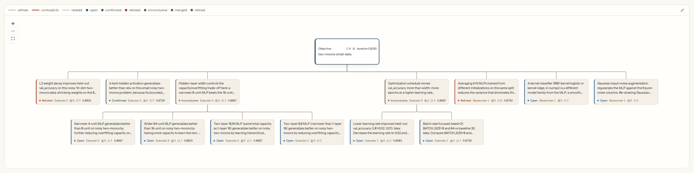
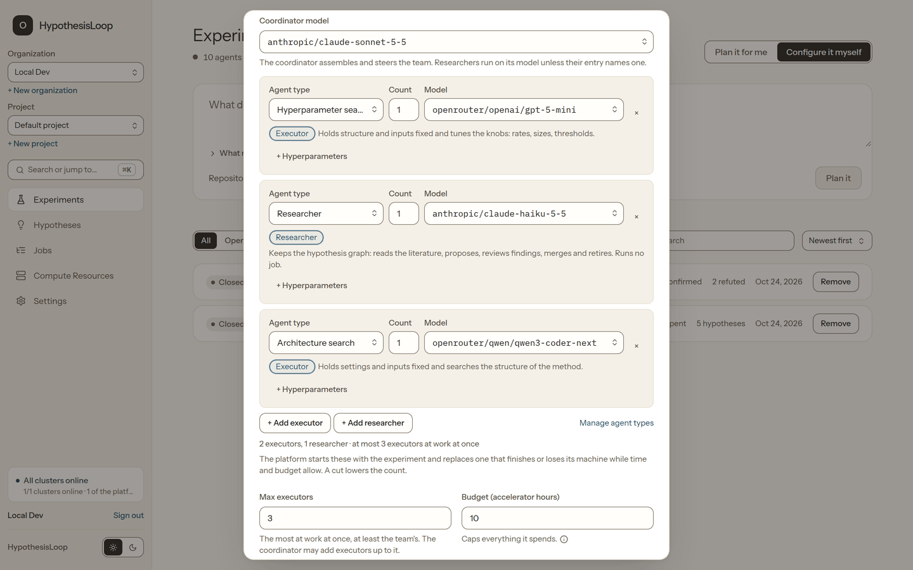

# HypothesisLoop

**The control plane for autonomous ML research.** You state an objective and the metrics that
define success. A team of LLM agents proposes hypotheses, tests them as real jobs on your compute
and records every result, so each claim can be traced and rerun. A multi-cluster scheduler splits
accelerator capacity by quota and keeps the scheduling details away from the agents.

It supports:

- Long-running experiments where a team of agents works the same hypothesis graph, each on a model of its own
- Single jobs, hyperparameter sweeps and adaptive search
- RL and other mixed jobs: a learner beside many actors runs as one job
- Distributed multi-node training, with ranks and the rendezvous address set for you
- NVIDIA GPUs, Tenstorrent chips, TPUs, other Kubernetes devices and plain CPU cores
- Your Kubernetes clusters and bare-metal nodes, and rented compute (vast.ai, Runpod)

## UI

A Next.js dashboard follows experiments, hypotheses, jobs and agents. The screenshots show a real
run: a coordinator, a researcher and several executors, each on a model of its own (Claude and
OpenRouter), in fly VMs, running jobs on a local cluster.



**The hypothesis graph of a run**

<table>
<tr>
<td width="50%">


**Experiments**: start one from a sentence, then follow each run's status, spend, agents and verdicts.

</td>
<td width="50%">



**New experiment, team**: an agent type, a count and a model for each entry, beside the coordinator's model.

</td>
</tr>
<tr>
<td width="50%">


**Inside an experiment**: its phase, the measured baseline, the budget used, the standings and the coordinator's summary.

</td>
<td width="50%">


**Team and agents**: the team the run keeps at work with each entry's model, and every agent's role, state and model.

</td>
</tr>
<tr>
<td width="50%">


**Hypotheses**: each claim's status, findings and best result.

</td>
<td width="50%">


**Inside a hypothesis**: the claim, its links, the branches that implement it, findings, comments and the jobs that test it.

</td>
</tr>
<tr>
<td width="50%">


**Jobs**: every job of the experiment, filtered by status and agent, with its accelerator, last metric and cost.

</td>
<td width="50%">


**Job detail**: the result, what the job ran and why, its cost, its metrics over the run and its logs.

</td>
</tr>
</table>

## How it works

Research runs as a loop. Someone sets an objective once. Hypotheses are proposed, tested with real
compute, and confirmed or refuted, again and again, by whoever picks up the thread next. A claim is
registered before it costs anything, and a job that tests it ends in a written finding.

- **Experiment.** An objective with a budget, metrics, a length and a team. Its code lives in a git repository, and every agent works on a branch of its own.
- **Team.** The *coordinator* steers and writes the summary. *Researchers* own the hypothesis graph and run no jobs. *Executors* implement ideas, run jobs and report them, and are ranked. A *baseline agent* measures the control first. A *reviewer* reruns others' claims.
- **Hypotheses.** A graph of claims. Each builds on the objective or on an earlier claim and ends confirmed, refuted or inconclusive.
- **Jobs.** One training or evaluation run that tests one hypothesis. A job may span several nodes, and it is admitted whole or not at all.
- **Scheduler.** It places jobs across clusters by quota, tier and capacity. A guaranteed job can preempt burst work, burst work fills idle capacity, and a job lost to an infrastructure fault is requeued without counting against its agent.
- **Compute.** Kubernetes clusters, bare-metal nodes, or machines the control plane rents per job.

Details: [docs/experiments.md](docs/experiments.md).

## Quickstart

You need podman, kubectl, helm, Go and Node. This path runs the stack on one machine, with a local
k3s cluster for jobs.

```bash
podman machine init --rootful --cpus 4 --memory 4096 --disk-size 40 && podman machine start   # macOS
cp .env.example .env     # fill in the keys; make dev names any it misses
make dev                 # control plane at :8081, UI at :3000
make k3s-up              # a local cluster for jobs
```

Then start an experiment from the examples:

```bash
export API_URL=http://localhost:8081 PATH="$PWD/localdev/.bin:$PATH"
export HL_TOKEN="$(make -s staff-token)"
hl project list          # copy a project id
# add project_id, repository and branch to tests/experiments/dummy-data-search-demo/.hypothesisloop/experiment.yaml
hl platform-experiments start tests/experiments/dummy-data-search-demo
```

`start` pushes the directory as a branch and creates the experiment. With
`coordinator_in_agentsandbox: true`, as in the example, the platform runs the coordinator, measures
the baseline and starts the team. `hl platform-experiments get --platform-experiment PE` says what
the run waits for. You can also type a goal on the Experiments page and let a planner propose the
experiment. [docs/setup.md](docs/setup.md) covers the other ways to run and attach compute.

## Models

Every agent runs on a model written `<provider>/<model id>`, set per team entry in the wizard, the
experiment file, `hl` and the API.

| Provider | Models | Credential |
|---|---|---|
| `anthropic` | Claude, on the Claude subscription | `MODEL_ANTHROPIC_OAUTH_TOKEN` |
| `openrouter` | any OpenRouter model that takes tools | `MODEL_OPENROUTER_API_KEY` |
| `openai` | OpenAI models, on a ChatGPT subscription | `MODEL_OPENAI_AUTH_JSON` |

A provider is served while its credential is set. `hl models --search kimi` lists what an agent can
run on. Agents call the control plane's model proxy with their own token and hold no credential,
and the control plane records each call's cost per agent.

## CLI

`hl --help` and `hl <command> --help` list every command and flag.

```bash
hl platform-experiments start DIR            # push DIR as a branch and create its experiment
hl platform-experiments get                  # status and what the run waits for
hl platform-experiments agents add --role researcher --in-agentsandbox --model openrouter/moonshotai/kimi-k2
hl platform-experiments agents message AGENT --text "..."   # steer an agent
hl situation                                 # time, budget, capacity and each agent's work
hl results                                   # standings on the declared metrics
hl capacity                                  # live accelerators and cores per cluster
hl hypothesis submit --builds-on root --text "..."
hl hypothesis get HYP                        # links, jobs, findings and comments
hl job submit .hypothesisloop/job.yaml --hypothesis HYP --theory "..."
hl job status JOB                            # also: wait, metrics, logs, cost, cancel
hl cluster add my-cluster                    # print the command that attaches a cluster
hl watch --all --follow                      # stream the events of an experiment
```

Set `API_URL` and `HL_TOKEN` (an API key, a user token or a staff token). An agent's or
coordinator's token supplies the experiment and agent, and a person names them with
`--platform-experiment` and `--agent`. Lists print one JSON object per line.

## Architecture

```
agents (hosted or your own) ──► control plane ◄── runtime agents (Kubernetes, bare metal)
UI, hl                              │                      │
                  Postgres · Memgraph · GreptimeDB · object store
                                    └──► rented machines (vast.ai, Runpod)
```

- **Control plane.** `control-service` serves the whole agent and UI API on one port, and
  `metrics-service` turns metric pushes into stage boundaries and evictions. Postgres holds desired
  state, Memgraph the hypothesis graph, GreptimeDB the metrics, and an S3-compatible store the
  durable data. It runs as a Docker Compose stack locally and as a Helm chart elsewhere.
- **Runtime agents.** One per environment that runs jobs, and the only part that holds that
  environment's credentials: a cluster agent and node agents on Kubernetes
  (`runtime/k8s`), or one `bare-agent` process on a node with a container engine
  (`runtime/bare-metal`). They fetch desired state, converge to it and report. The control plane
  never connects into them.
- **Hosted agents** run Claude Code on fly or e2b machines the control plane rents, and reach models
  and git only through the control plane.
- **Scheduler** (`controlplane/service/scheduler`) keeps desired state in Postgres and reads actual
  state from what the runtimes report to the metrics store.

## Docs

| Page | Contents |
|---|---|
| [docs/experiments.md](docs/experiments.md) | The experiment file, roles and team, models, starting a run, the baseline, jobs, multi-node placement, why a job waits |
| [docs/setup.md](docs/setup.md) | Running locally, attaching compute, configuration, sign-in, GitHub, the database, publishing images |
| [docs/install-cluster.md](docs/install-cluster.md) | Connecting a Kubernetes cluster or a bare-metal node |
| [docs/development.md](docs/development.md) | Make targets, endpoints, tests |
| [tests/experiments](tests/experiments) | Working example experiments |

## License

MIT - see [LICENSE](LICENSE).
